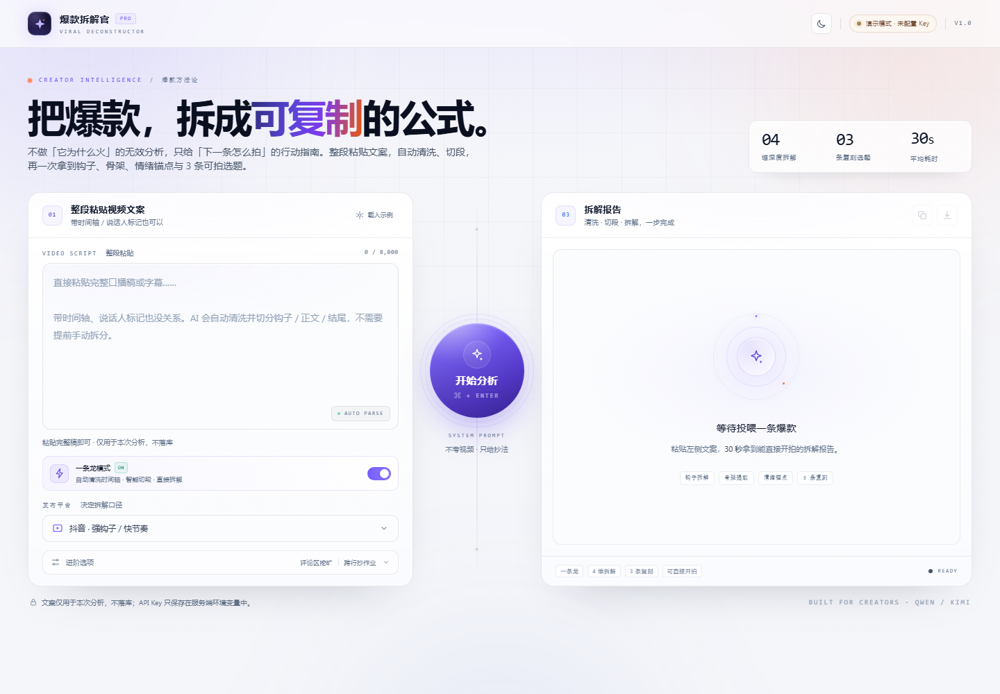
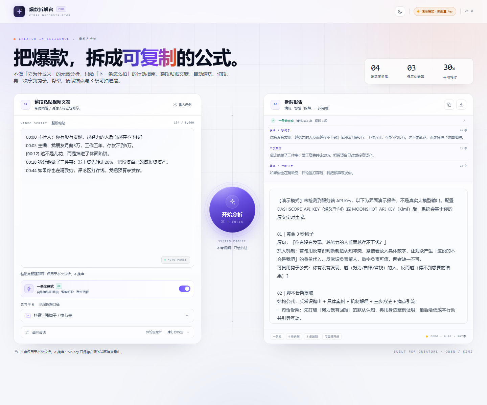

# 爆款拆解官 · Viral Deconstructor

一个「整段粘贴 → 自动清洗切段 → 30 秒拿到可复制脚本」的极简单页 SaaS 工具。

前端：原生 HTML + Tailwind CSS（已预编译，无需构建即可部署），支持**浅色 / 深色**两套主题
后端：Vercel Serverless Function，代理调用通义千问 / Kimi / 任意 OpenAI 兼容接口
核心：内置「千万粉丝团队首席爆款拆解官」System Prompt，只输出**能直接开拍**的拆解，不做无效夸奖。



深色主题：[查看截图](docs/preview-dark.png) · 结果态：[查看截图](docs/preview-result.png) · 移动端：[查看截图](docs/preview-mobile.png)

## 能做什么

- **一条龙模式**：整段粘贴带时间轴 / 说话人标记的口播稿，自动清洗并按钩子、正文、结尾切段，不需要先在外部手动拆分
- **黄金 3 秒钩子**：提取原句，说明心理机制，给可复用钩子公式
- **脚本骨架提取**：一句话结构 + 0-3s / 3-15s / 结尾节奏拆解
- **情绪价值锚点**：点赞、评论、转发/收藏的真实驱动力
- **「直接抄」生成器**：3 个不同方向的新标题 + 前 3 秒开场白
- **评论区挖矿**（可选）：分析高赞评论，生成一条可置顶的「神评论」
- **跨行抄作业**（可选）：保留原骨架，把套路迁移到目标赛道
- **主题切换**：右上角一键切换浅色 / 深色，选择会自动记住
- 平台适配：抖音 / 小红书 / 视频号 / B 站 / 快手 / YouTube Shorts

## 目录结构

```
爆款拆解官/
├─ index.html              # 单页 UI
├─ assets/
│  ├─ app.js               # 交互：请求、加载态、复制、下载
│  └─ styles.css           # Tailwind 预编译产物（已提交）
├─ src/input.css           # Tailwind 源文件 + 自定义设计系统
├─ api/
│  └─ analyze.js           # Serverless AI 接口 + System Prompt + 清洗切段 + 演示报告
├─ scripts/dev.mjs         # 本地静态服务器 + API 联调（不需要 Vercel CLI）
├─ docs/                   # 浅色 / 深色 / 移动端截图
├─ tailwind.config.js
├─ vercel.json
├─ .env.example
└─ package.json
```

## 方式一：零配置先跑起来（演示模式）

不配置任何 Key，项目会自动进入**演示模式**：接口返回本地模板报告，用于先看完整交互。页面顶部会明确显示「演示模式 · 未配置 Key」，不会把模板伪装成 AI 结果。

```bash
cd 爆款拆解官
npm install
copy .env.example .env.local   # macOS / Linux 用 cp
npm run dev
```

打开 <http://127.0.0.1:4173>。

> 不要直接双击 `index.html`。页面请求 `/api/analyze`，需要通过本地服务器运行。

## 一条龙模式与主题

### 一条龙模式（默认开启）

左侧可以直接粘贴**完整**口播稿或字幕，包括：

```text
00:00 主持人：你有没有发现，越努力的人反而越存不下钱？
00:05 主播：我朋友月薪 3 万，工作五年，存款不到 5 万。
[00:12] 这不是乱花，而是掉进了体面陷阱。
```

工具会在服务端先做：

1. 清洗时间轴、说话人 / 旁白 / 字幕标记
2. 按语义把文案切成「黄金 3 秒钩子 / 承接与背景 / 核心内容 / 结尾行动引导」
3. 把切好的结构直接交给大模型拆解，**不需要你提前在外部拆分再导入**

结果区会显示「清洗了多少字、切了几段」，点开即可查看自动切段结果。左侧开关可以关闭自动切段；关闭后仍会清洗时间轴，但会直接把整段文案交给模型。



### 主题切换

右上角的太阳 / 月亮按钮可以在浅色和深色之间切换，选择保存在浏览器 `localStorage` 中，刷新后保持。默认浅色。

### 差异化模块怎么触发

左侧「进阶选项」里有两个可选模块：

- **评论挖矿**：填入高赞评论后，报告会在 04 之后追加 `05｜评论区挖矿`
- **跨行迁移**：填入目标赛道后，报告会在 04 之后追加 `06｜跨行抄作业`

如果这两个字段不填，05 / 06 会被主动隐藏，也不会让模型凭空编造评论或赛道。想看到完整的差异化效果，需要先填入对应素材再分析。

## 方式二：接入真实大模型

### A. 通义千问（推荐，OpenAI 兼容接口）

1. 登录 [阿里云百炼控制台](https://bailian.console.aliyun.com/)，开通百炼服务。
2. 在「API-KEY 管理」创建一个 API Key。
3. 在 `.env.local` 中填写：

```dotenv
AI_PROVIDER=qwen
DASHSCOPE_API_KEY=sk-你的Key
AI_MODEL=qwen-plus
ALLOW_DEMO=false
```

- `qwen-plus`：效果与速度平衡，适合本工具。
- `qwen-turbo`：更快、更便宜，适合高频使用。
- 新用户通常有免费 Token 额度，但**不是永久免费**，具体额度和有效期以百炼控制台为准。

### B. Kimi（Moonshot AI）

1. 登录 [Moonshot 开放平台](https://platform.moonshot.cn/console/api-keys)。
2. 创建 API Key。
3. 配置：

```dotenv
AI_PROVIDER=kimi
MOONSHOT_API_KEY=sk-你的Key
AI_MODEL=moonshot-v1-32k
ALLOW_DEMO=false
```

默认用 `moonshot-v1-32k`，是为了容纳长文案（8k 版本可能装不下 8000 字输入）。Kimi 开放平台通常会赠送试用额度，是否长期免费以平台政策为准。

### C. 想用完全免费的模型（OpenRouter）

项目支持任意 OpenAI 兼容服务。可以用 OpenRouter 上当前可用的 `:free` 模型（免费模型有速率限制，模型列表会变动，以 OpenRouter 模型页为准）：

```dotenv
AI_PROVIDER=openrouter
OPENROUTER_API_KEY=sk-or-v1-你的Key
AI_MODEL=qwen/qwen3-8b:free
ALLOW_DEMO=false
```

### D. 任意兼容接口

```dotenv
AI_PROVIDER=custom
AI_BASE_URL=https://你的域名/v1
AI_API_KEY=你的Key
AI_MODEL=你的模型名
ALLOW_DEMO=false
```

后端请求的是 `${AI_BASE_URL}/chat/completions`，格式与 OpenAI Chat Completions 一致。

## 部署到 Vercel

### 方案 A：GitHub 导入（推荐）

1. 将整个 `爆款拆解官` 目录推到 GitHub 仓库。
2. 打开 [vercel.com/new](https://vercel.com/new)，导入该仓库。
3. 配置：
   - **Framework Preset**：`Other`
   - **Root Directory**：仓库根目录（如果仓库里只有这个项目就保持默认）
   - **Build Command**：留空（`assets/styles.css` 已预编译；想强制重新编译 Tailwind 时再填 `npm run build`）
   - **Output Directory**：`.`
4. 在 **Settings → Environment Variables** 添加（Production / Preview / Development 都勾上）：
   - `AI_PROVIDER` = `qwen` 或 `kimi`
   - `DASHSCOPE_API_KEY` 或 `MOONSHOT_API_KEY`
   - `ALLOW_DEMO` = `false`（正式环境建议关闭演示兜底）
   - 可选：`AI_MODEL`
5. 点击 **Deploy**。环境变量修改后需要 **Redeploy** 才会生效。
6. 验证：
   - 打开 `https://你的项目.vercel.app/api/analyze`
   - 看到 `"configured":true,"demo":false` 即代表 Key 配置成功
   - 回到首页，右上角应显示 `通义千问 · qwen-plus` 或 `Kimi · moonshot-v1-32k`

### 方案 B：Vercel CLI

```bash
cd 爆款拆解官
npm i -g vercel
vercel login
vercel

# 按提示关联/创建项目后，添加环境变量
vercel env add AI_PROVIDER production
vercel env add DASHSCOPE_API_KEY production
vercel env add ALLOW_DEMO production

# 部署到生产
vercel --prod
```

> Vercel 免费套餐的函数时长限制可能因账户/计划调整。项目已在 `vercel.json` 里设置 `maxDuration: 60`；若部署时提示超出限制，改成账户允许的值即可。

## 本地开发

```bash
npm install
npm run dev          # 静态页面 + /api/analyze 一起启动
npm run build:css    # 修改 Tailwind class 后重新生成 assets/styles.css
npm run watch:css    # 开发时监听 CSS 改动
```

`.env.local` 与 `.env` 会被 `scripts/dev.mjs` 自动读取；不要提交到 Git。

## 接口说明

### `GET /api/analyze`

返回引擎状态，不暴露 Key：

```json
{
  "ok": true,
  "configured": true,
  "demo": false,
  "provider": "qwen",
  "providerLabel": "通义千问",
  "model": "qwen-plus"
}
```

### `POST /api/analyze`

```json
{
  "script": "视频文案，必填，可带时间轴 / 说话人标记，最多 8000 字",
  "platform": "douyin",
  "comments": "可选，高赞评论，每行一条，最多 3000 字",
  "targetNiche": "可选，目标赛道，最多 40 字",
  "autoSegment": true
}
```

成功：

```json
{
  "ok": true,
  "demo": false,
  "provider": "qwen",
  "providerLabel": "通义千问",
  "model": "qwen-plus",
  "result": "01｜黄金 3 秒钩子……",
  "usage": { "prompt_tokens": 1000, "completion_tokens": 900 },
  "pipeline": {
    "originalChars": 154,
    "cleanedChars": 115,
    "segments": [
      { "id": "hook", "label": "黄金 3 秒钩子", "chars": 56, "text": "……" },
      { "id": "body", "label": "正文展开", "chars": 31, "text": "……" },
      { "id": "cta", "label": "结尾 / 行动引导", "chars": 24, "text": "……" }
    ]
  }
}
```

失败：HTTP 4xx/5xx，body 为 `{ "error": "给用户看的错误", "hint": "怎么解决" }`。

## 修改业务提示词

核心 System Prompt 在 `api/analyze.js` 顶部的 `SYSTEM_PROMPT` 常量里。

它已经内置了：

1. 角色设定：千万粉丝自媒体团队的首席爆款拆解官
2. 只做「怎么抄」，不做「为什么火」
3. 固定 4 段输出 + 可选的评论区挖矿 / 跨行抄作业
4. 平台适配规则
5. 把「整段原始字幕」当作正常输入，不要求用户再手动拆分
6. 防提示词注入、防编造素材的约束

修改后重新部署即可。前端不需要改动。

## 安全与成本

- **API Key 只存在服务端环境变量**，浏览器代码里没有任何 Key。
- 接口对文案/评论长度做截断，并做基础内存限流（默认 12 次/分钟/IP）。Serverless 多实例下限流只能算尽力而为；正式商用建议接入 Vercel KV / Upstash。
- 不写入数据库，不保存用户文案；服务端日志只记录上游错误摘要，不打印完整文案。
- `ALLOW_DEMO=true` 时，未配置 Key 会返回带「演示模式」标识的模板报告；正式环境请设为 `false`，避免用户误把模板当真实分析。
- 大模型调用按厂商计费，免费额度/试用额度以各平台当前政策为准。

## 常见问题

| 现象 | 原因 / 解决 |
| --- | --- |
| 页面显示「演示模式」 | 环境变量没加，或加完没 Redeploy；检查 `/api/analyze` 的 `configured` |
| 页面显示「后端未连接」 | 本地没运行 `npm run dev`；或 `api/analyze.js` 没有部署成功 |
| 401 / 403 | API Key 复制不完整、被删除，或账号未开通对应模型 |
| 429 | 免费额度用尽或触发限流；稍后再试，或换 `qwen-turbo` / 其他模型 |
| 504 / 超时 | 模型响应慢；确认 `vercel.json` 的 `maxDuration` 生效，或换更快模型 |
| 改了样式不生效 | Tailwind 是预编译的，运行 `npm run build:css` 后重新部署 |
| 提示找不到 `tailwindcss` | 先执行 `npm install` |

---

如果这个工具帮你拆出了下一条爆款，记得把「抄」来的结构用在原创表达上。
